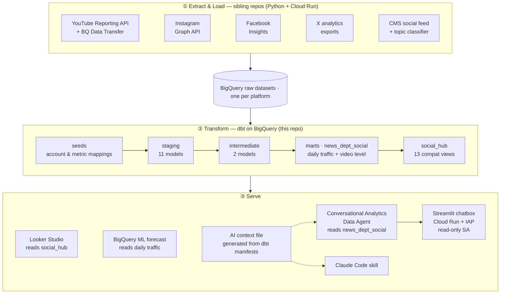
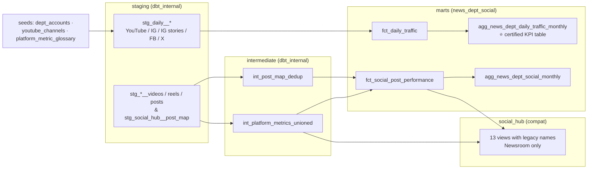

# TaiwanPlus News Dept Social Analytics — dbt on BigQuery, AI-ready

> A **dbt transformation layer** that brings **4 social platforms** (YouTube / Instagram / Facebook / X) × **3 newsroom units** into one tested, documented model on BigQuery. It **replaced 13 legacy BigQuery views without rewiring a single Looker Studio dashboard**, and the same definitions feed a **read-only LLM data chatbox** that passes **20/20** golden eval questions.

    



---

## TL;DR

- **Zero-downtime migration.** Rebuilt 13 legacy `social_hub` views in dbt **under the same names**. A row-level reconcile script proved the outputs identical (only float noise < 1e-11 and 2 rows of `APPROX_QUANTILES` approximation differed), so **Looker Studio needed no rewiring**.
- **Resolved a metric ambiguity.** "Views" meant two different things in different reports. I split it into **daily traffic** (the KPI: views that *happened* in the period) and **video level** (for root cause: *cumulative* views by publish date). For the same unit and month, the two can differ by **~2×**, which is why the reports used to disagree.
- **Fixed silent data bugs.** Summing the raw Instagram snapshot table **inflates views 100×+**. The account-level daily deltas also **went negative** whenever the API dropped reels (at one point more than half of an account's reels vanished from the feed in a single day). Per-reel snapshot deltas with a running max fixed it: one month's watch time went from a **six-figure negative** number to the correct positive value.
- **Tested and documented.** **39 tests** (30 generic + 9 singular), source freshness on every actively updated source, and `persist_docs` so every definition also lands in **BigQuery column descriptions**. Business definitions live in **one file** ([`_definitions.md`](models/docs/_definitions.md)).
- **Semantic layer → AI.** 2 semantic models, 17 metrics and 2 saved queries are compiled into an AI context file. A Conversational Analytics agent plus a Streamlit chatbox (Cloud Run behind IAP, **verified read-only** service account) passes **20/20** eval questions (10 questions × original/paraphrase) with a **median latency of 20.4 s**. A number checker flags any figure in the answer that is not in the query result.
- **Honest forecasting backtest.** Multi-cutoff backtest of **TimesFM vs ARIMA_PLUS vs naive**: TimesFM wins on X (**11%** 28-day error vs 21% naive), but **naive beats it on Newsroom YouTube** (18% vs 27%). So forecasts are used as a reference in the biweekly report, never as a KPI.

This repo is less "I wrote some SQL models" and more **"how I made a messy multi-platform metric trustworthy enough for both dashboards and an LLM to answer from"**. The interesting part is [§3](#3-key-engineering-decisions-).

---

## 1. Problem & Context

TaiwanPlus is an English-language Taiwanese news outlet. Its **News Department** has three units — **Newsroom**, **Talks** and **Connected** — publishing video on YouTube (5 channels), Instagram, Facebook and X. Leadership kept asking one question: *"How is the News Department doing on social?"* There was no single answer, because:

| Problem | Why it hurts |
|---|---|
| Every platform counts a "view" differently | YouTube ~1 s (since 2026-08-27; ~30 s before), IG ~0.3–0.5 s, FB 3 s, X 2 s continuous. Absolute numbers are not comparable across platforms. |
| The legacy view layer (`social_hub`) covered **Newsroom only** | Talks and Connected were invisible in department-level reporting. |
| Raw tables have traps | IG stores daily cumulative *snapshots* (one reel = many rows), APIs skip days, YouTube changed its definition mid-year. |
| Two kinds of "monthly views" | "Views that happened in September" vs "September videos' views to date" were used interchangeably. |
| Live dashboards depended on the old views | Any migration had to keep view names and outputs identical. |

**Scope of this repo:** transformation, testing and metric definitions only. Extract/load stays in the Python + Cloud Run jobs of the sibling repos; the contract between the two sides is the set of BigQuery raw tables declared in [`models/staging/_sources.yml`](models/staging/_sources.yml).

---

## 2. Data model



| Layer | Models | Materialization | Prod dataset | Purpose |
|---|---|---|---|---|
| Staging | 11 | view | `dbt_internal` | One model per raw table: rename, cast, dedupe snapshots, add `dept_scope` |
| Intermediate | 2 | view | `dbt_internal` | Union the 4 platforms into one long table; dedupe the CMS post map |
| Marts — **daily traffic** | `fct_daily_traffic`, `agg_news_dept_daily_traffic_monthly` | view | `news_dept_social` | Day × unit × platform × content type. **Overall KPI.** |
| Marts — **video level** | `fct_social_post_performance`, `agg_news_dept_social_monthly` | view | `news_dept_social` | One row per video post. **Root cause**: which videos/topics performed. |
| Compat | 13 | view | `social_hub` | Same names and outputs as the legacy views, for Looker Studio |
| Seeds | 3 | table | `news_dept_social` | Governed mappings: unit × platform × raw table, YouTube channel → unit, metric glossary |

Dev builds go to a personal schema; prod routing is handled by [`macros/generate_schema_name.sql`](macros/generate_schema_name.sql).

---

## 3. Key engineering decisions ⭐

> Each one follows **symptom → diagnosis → fix → result**.

### Decision 1 — Two grains, not one "views" number

**Symptom.** Two reports gave different "September views" for the same account. For one unit the gap was ~2×.

**Diagnosis.** One report summed views that *happened* in September (daily traffic). The other summed lifetime views of videos *published* in September (video level). Both are valid, and they answer different questions.

**Fix.** Modeled them as two separate fact tables with different metric names (`traffic_views` vs `video_views`), plus routing rules in the docs: *"how are we doing"* → daily traffic, *"why / which videos"* → video level, *"why did X change"* → both, clearly labelled. Daily traffic became the **certified KPI** table.

**Result.** One agreed KPI, and an explicit rule for when the other number is the right one. The rule is enforced in the AI context as well, and eval questions check that the chatbox picks the right grain.

### Decision 2 — Instagram: never `SUM` a snapshot table

**Symptom.** A naive `SUM` over the IG raw table produced views **100×+** too high. Separately, monthly IG watch time showed a **six-figure negative** total for one month.

**Diagnosis.** The IG table stores a **daily cumulative snapshot per reel**, so each reel appears once per day. The legacy daily report computed `today's account total − yesterday's`. That goes negative whenever the API **skips reels** (more than half of an account's reels missing on one day; watch hours returned as 0 on others).

**Fix.** [`stg_daily__instagram_reel_deltas`](models/staging/stg_daily__instagram_reel_deltas.sql) computes each reel's delta against **its own** previous snapshot, takes cumulative values as a **running max** (so a missing or zero reading can't create a negative), and counts a new reel only if it was released within 3 days. When the IG API changed its method on 2026-06-01, the switch was recorded in a `source_method` column and documented as a caveat (the old method reads ~10–20% higher).

On 2026-10-27 watch hours moved upstream: the same per-reel logic now lives in the BigQuery view `Instagram_data.ig_daily_watch_hours` (`TaiwanPlus_api/sql/ig_daily_watch_hours.sql`). It serves the team's daily IG report and dbt alike. Up to 2026-10-25 it returns the hand-corrected history from the team's Excel log (`ig_daily_watch_hours_history`), so dbt and the report show the same numbers. `assert_ig_watch_hours_matches_source` checks that monthly totals agree.

**Result.** No negative days left. The non-negative test now covers views **and** watch hours with no exceptions, and normal months are unchanged.

### Decision 3 — Don't mistake a definition change for growth

**Symptom.** YouTube Views roughly doubled from July to September.

**Diagnosis.** On **2026-08-27 YouTube relaxed its view threshold** from ~30 s to ~1 s. Views per engaged view went from ~1.1–1.3× to ~2.1–2.7× overnight.

**Fix.** Views remains the KPI (it is what YouTube Studio shows), and `engaged_views` (close to the old definition) is added as a **reference metric** at both grains. The docs and AI guide require both whenever a period spans 8/27.

**Result.** The chatbox correctly reports, for example, that one unit's Views rose ~57% while its engaged views **fell ~30%**, so that unit's "growth" came entirely from the definition change.

### Decision 4 — Encode the cross-platform comparison trap

**Symptom.** Facebook always "wins" on raw views, and people concluded FB had the lowest bar.

**Diagnosis.** FB's 3-second threshold is actually the **strictest** of the four. The volume comes from FB's large **Philippine audience**: in 2026, Philippines-related Newsroom posts averaged **7.8×** the views of other posts, and 1.7% of posts produced 12% of FB views.

**Fix.** The definition lives once in [`_definitions.md`](models/docs/_definitions.md), with presentation rules: list platforms separately, compare each platform against its own trend, and never rank platforms on absolute views.

**Result.** These rules reach dashboards (BigQuery column descriptions), the AI agent and the eval suite from a single source.

### Decision 5 — Make the migration provably safe

**Symptom.** Live Looker Studio dashboards were built on 13 hand-written BigQuery views. A broken migration would be visible to leadership immediately.

**Fix.**
- A compat layer reproduces the legacy views **with identical names and columns**.
- [`scripts/reconcile_social_hub.py`](scripts/reconcile_social_hub.py) diffs every view **row by row**: exact match on non-float columns, 1e-6 relative tolerance on floats.
- The prod cutover separates datasets by audience: `dbt_internal` (not for humans), `news_dept_social` (analysts and AI) and `social_hub` (BI).

**Result.** All 13 views reconciled. The only differences were float noise < 1e-11 and 2 rows of an `APPROX_QUANTILES` median, which also change when the *old* view's own SQL is rerun. Cutover required **zero dashboard changes**.

---

## 4. Data quality & testing

**39 dbt tests** run with every `dbt build`.

- **30 generic tests:** `unique` / `not_null` on every grain key, and `accepted_values` on `dept_scope`, `platform` and `content_type`. Source tests cover upstream keys too.
- **9 singular tests:**

| Test | What it guards |
|---|---|
| [`assert_daily_traffic_matches_sources`](tests/assert_daily_traffic_matches_sources.sql) | The fact table equals an independent sum of the raw sources |
| [`assert_daily_traffic_monthly_agg_matches_fct`](tests/assert_daily_traffic_monthly_agg_matches_fct.sql) | The certified monthly KPI table equals the daily fact |
| [`assert_monthly_agg_matches_fct`](tests/assert_monthly_agg_matches_fct.sql) | Same, for the video-level grain |
| [`assert_daily_traffic_non_negative`](tests/assert_daily_traffic_non_negative.sql) | No negative views or watch hours (see Decision 2) |
| [`assert_dept_platform_in_dept_accounts`](tests/assert_dept_platform_in_dept_accounts.sql) | Every unit × platform in the data is registered in the governed seed |
| [`assert_youtube_channels_match_video_news_broad`](tests/assert_youtube_channels_match_video_news_broad.sql) | The channel → unit seed agrees with the upstream YouTube table |
| [`assert_post_map_post_has_single_vod`](tests/assert_post_map_post_has_single_vod.sql) | A social post never maps to two CMS videos (prevents fan-out) |
| [`assert_classified_vod_not_shorts`](tests/assert_classified_vod_not_shorts.sql) | Topic-classified long-form videos are not Shorts |
| [`assert_vod_publish_date_matches_vod_id`](tests/assert_vod_publish_date_matches_vod_id.sql) | CMS IDs and publish dates are consistent |

- **Source freshness:** thresholds are tuned per source to how it is actually loaded. For example, weekly loads warn after 8 days and error after 14; the YouTube owner report has a known reporting lag, so it was relaxed to 7/10 days based on observed latency. A retired account (Connected IG) is excluded from freshness checks on purpose.
- **Documentation as data:** `persist_docs` writes every model and column description into BigQuery, so BigQuery's own Gemini features read the same definitions as humans do.
- **Daily checks in prod:** Cloud Scheduler triggers a Cloud Run Job every day after ingestion. The job runs `dbt source freshness` and `dbt test` against prod and emails an alert if either fails. All models are views, so the data is always current and nothing needs a daily rebuild. What changes day to day is the data itself, so the job only checks it. It runs as a **read-only** service account and cannot modify prod.
- **CI:** GitHub Actions builds the whole project into an isolated `dbt_ci` dataset on every PR and runs every test, plus the chatbox unit tests. It authenticates through **Workload Identity Federation**, so no service account key exists anywhere. Details: [`orchestration/README.md`](orchestration/README.md).

---

## 5. Semantic layer & AI interface

**Semantic layer** ([`models/marts/_marts.yml`](models/marts/_marts.yml)): 2 semantic models (video level, daily traffic), 17 metrics (per-platform views, engaged views, watch time, engagements, `engagement_rate`, `avg_views_per_post`, …) and 2 saved queries (`news_dept_social_performance`, `newsroom_social_performance`).

**One definition source → AI.** [`scripts/build_ai_context.py`](scripts/build_ai_context.py) reads `target/manifest.json` and `semantic_manifest.json`, translates metrics into BigQuery SQL against prod relation names, and generates [`ai_context/news_dept_social_context.md`](ai_context/news_dept_social_context.md). That file is **generated, never hand-edited**. It drives:

| Consumer | How |
|---|---|
| **Conversational Analytics Data Agent** | [`ai_context/ca_agent/`](ai_context/ca_agent/) builds the agent config from the context file and deploys it |
| **Data chatbox web app** | [`chatbox_app/`](chatbox_app/): Streamlit on Cloud Run behind IAP |
| **Claude Code skill** | [`ai_context/claude_skill/SKILL.md`](ai_context/claude_skill/SKILL.md) (versioned copy) |

**Chatbox design highlights**
- **Least privilege.** The app runs as a read-only service account that can only read `news_dept_social`. [`verify_readonly.py`](ai_context/ca_agent/verify_readonly.py) proves that writes are rejected.
- **Two answer modes.** *Fast* (CA API fetch + answer) for lookups. *Deep* (CA API fetch → Gemini Flash streams the analysis) for "why / is it real / which is best". Deep mode replaced the CA API's THINKING mode: median **20.4 s vs ~29 s**, same quality, and text starts streaming as soon as data arrives.
- **Guardrails.** [`narrator.unmatched_numbers`](chatbox_app/narrator.py) flags any number in the answer that is not in the query result. [`notes.py`](chatbox_app/notes.py) appends rule-based caveats (YouTube 8/27 change, IG 6/1 method change, retired accounts, incomplete current month) only when the answer omitted them, and it is unit-tested.
- **Evaluation.** [`ai_context/eval_questions.yml`](ai_context/eval_questions.yml) holds golden questions with reference SQL, `must_mention` and `must_not` rules: traps such as cross-platform ranking, the wrong grain and the definition change. Latest deep-mode run: **20/20 pass** ([summary](ai_context/ca_agent/eval_results/SUMMARY.md)).

Operational runbook (deploy, IAP access, logging, cost): [`chatbox_app/README.md`](chatbox_app/README.md) (internal, in Chinese).

**Forecast backtest** ([`scripts/run_forecast_backtest.py`](scripts/run_forecast_backtest.py) → [`analyses/forecast_backtest_results.md`](analyses/forecast_backtest_results.md)): 6 cutoffs, 14 days apart, with 28- and 91-day horizons. Models were TimesFM, ARIMA_PLUS and naive, on 11 unit × platform series.

| 28-day total, mean abs. error | ARIMA_PLUS | naive | TimesFM |
|---|---|---|---|
| News Dept · X | 42% | 21% | **11%** |
| News Dept · Facebook | **31%** | 42% | **31%** |
| News Dept · YouTube | 46% | 39% | **32%** |
| Newsroom · YouTube | 19% | **18%** | 27% |
| Talks · Instagram | 67% | **61%** | 93% |

No model wins everywhere, and viral-driven series (Talks) aren't forecastable at this horizon. Forecasts are therefore shown only as context in the biweekly report.

---

## 6. Repository structure

| Path | Contents |
|---|---|
| [`models/staging/`](models/staging/) | One model per raw table + [`_sources.yml`](models/staging/_sources.yml) (the E/L contract, with freshness) |
| [`models/intermediate/`](models/intermediate/) | Platform union, post-map dedupe |
| [`models/marts/`](models/marts/) | Daily-traffic and video-level facts/aggregates, time spine, semantic layer YAML |
| [`models/social_hub/`](models/social_hub/) | 13 legacy-compatible views for Looker Studio |
| [`models/docs/_definitions.md`](models/docs/_definitions.md) | **Single source of business definitions** (change definitions only here) |
| [`seeds/`](seeds/) | Governed mappings: `dept_accounts`, `youtube_channels`, `platform_metric_glossary` |
| [`tests/`](tests/) | 9 singular data tests |
| [`macros/`](macros/) | Prod dataset routing; shared macro for per-platform compat views |
| [`scripts/`](scripts/) | Reconcile, AI-context generator, eval reference runner, forecast backtest |
| [`ai_context/`](ai_context/) | Generated AI context, eval question bank, CA agent build/deploy/eval, Claude skill |
| [`chatbox_app/`](chatbox_app/) | Streamlit chatbox (Dockerfile, CA client, narrator, caveat notes, tests) |
| [`analyses/`](analyses/) | Forecast backtest results |
| [`orchestration/`](orchestration/) | Daily prod checks (Cloud Run Job + Scheduler + alert) and GCP setup for CI |
| [`.github/workflows/`](.github/workflows/) | CI: dbt build + tests into `dbt_ci`, chatbox unit tests |
| [`profiles/`](profiles/) | Env-driven dbt profile for CI and the daily job (no keys, no project ID) |

---

## 7. How to run

```bash
# 1. Auth + config (once). No project ID is hard-coded: Python reads GCP_PROJECT
#    (see .env.example), dbt sources use the project from your profile.
gcloud auth application-default login
export GCP_PROJECT=<gcp-project>       # Windows: setx GCP_PROJECT <gcp-project>

# 2. Profile — ~/.dbt/profiles.yml (not version-controlled)
#    taiwanplus_dbt:
#      target: dev
#      outputs:
#        dev:  {type: bigquery, method: oauth, project: <gcp-project>, dataset: dbt_<you>, location: asia-east1}
#        prod: {type: bigquery, method: oauth, project: <gcp-project>, dataset: <default_dataset>, location: asia-east1}
#    (prod models are routed to dbt_internal / news_dept_social / social_hub by generate_schema_name)
dbt debug

# 3. Build + test (run after the weekly E/L jobs)
dbt source freshness
dbt build                    # dev
dbt build --target prod      # deploy

# 4. Prove the compat layer matches the legacy views
python scripts/reconcile_social_hub.py --new <dev_dataset> --old social_hub

# 5. After changing definitions (_definitions.md, _marts.yml, seeds)
python scripts/build_ai_context.py      # regenerate the AI context file
python scripts/run_eval_reference.py    # reference answers for the eval questions
```

`dbt sl validate` / `dbt sl query` need dbt platform (`dbt_cloud.yml`). Without it, validate `target/semantic_manifest.json` with `dbt-semantic-interfaces`.

---

## 8. Tech stack

`dbt` (BigQuery adapter, `persist_docs`, semantic layer YAML spec) · `BigQuery` · `BigQuery ML` (ARIMA_PLUS, TimesFM) · `Python` (`google-cloud-bigquery`) · `Conversational Analytics API` (Data Agent) · `Gemini Flash` · `Streamlit` · `Cloud Run` · `Identity-Aware Proxy` · `Artifact Registry` / `Cloud Build` · `Cloud Logging` · `Looker Studio` · `GitHub Actions` · `Workload Identity Federation` · `Cloud Scheduler` · `Cloud Monitoring`

---

## 9. Data privacy

The TaiwanPlus data is **proprietary and not included**. This repo contains only SQL, YAML, Python and generated documentation. In this README the GCP project and service accounts are redacted (`<gcp-project>`), and results are given as **relative** figures (ratios, error rates, pass rates) rather than absolute audience numbers. The models, tests, scripts and methodology are the real production ones.

---

## 10. Future directions

- **Materialize hot marts** as tables or incremental models. Everything is a view today, so one chatbox question scans ~0.1–1.6 GB.
- **CD:** deploy to prod automatically on merge to `main` (CI and scheduled checks are in place; deploys are still manual). Add slim CI (`state:modified+` with `--defer`) once full CI builds get slow.
- **Snapshots** for slowly changing mappings (account ownership, channel → unit).
- **Query the semantic layer directly** (dbt platform) instead of compiling metrics into an AI context file.
- **Shorts detection for Talks / Connected**, which the upstream Shorts list doesn't cover yet.
