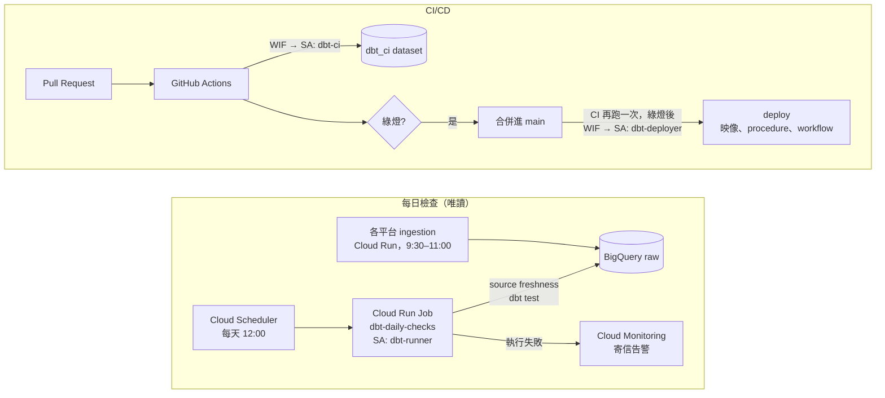
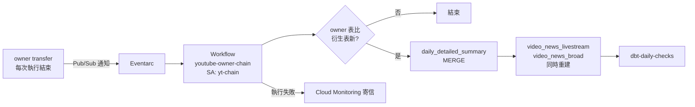

# 編排與 CI/CD

三件事：每天自動檢查 prod 的資料（編排）、每個 PR 自動驗證程式碼（CI）、合併進 main 後自動部署（CD）。



## YouTube owner 事件驅動鏈

YouTube 內容擁有者報表（BQ Data Transfer）沒有固定的「跑完」時間：每天 09:30 的排程執行通常沒有新資料，報表日 D 的資料第一次進來落在 **D+2 的 13:37–23:51**（2026-10 觀察 11 天），之後 D+3 上午還會再被修正重寫。原本三個 BQ 排程查詢用固定時間（09:30 / 09:50 / 13:00）去猜，結果每天都比資料早到一步，最新一天要等到隔天才進衍生表；`daily_detailed_summary` 甚至在報表進來前就跑完。

改成由事件觸發：



- **判斷有沒有新資料**：比 `__TABLES__.last_modified_time`，不需要另存狀態；同一份資料重複通知也只會重建一次。
- **SQL** 在 [`sql/`](sql/)，部署成 `youtube_channel_summary` 裡的 stored procedure（`refresh_*`），內容與原排程查詢逐字相同（只拿掉寫死的專案 ID）。需要時可手動重跑：`CALL youtube_channel_summary.refresh_video_news_broad();`
- **執行身分** `yt-chain`：只讀 `youtube_taiwanplus_owner`、只寫 `youtube_channel_summary`，取代原本用個人帳號執行的排程查詢。
- 12:00 的每日檢查保留，負責 10:25 前就到齊的 IG / FB；YouTube 由這條鏈在最後觸發檢查。

上線與回滾：

```bash
P="--project=<gcp-project> --billing-project=<gcp-project>"
# 1. 建立 SA、procedure、Pub/Sub 通知、workflow、Eventarc、告警
GCP_PROJECT=<gcp-project> ALERT_EMAIL=<you@example.com> bash orchestration/setup_youtube_chain.sh
# 2. 手動跑一次，確認三張表更新、dbt 檢查通過
gcloud workflows run youtube-owner-chain --location=asia-east1 --data='{}' $P
# 3. 停用被取代的三個排程查詢（只設 disabled，不刪除）
GCP_PROJECT=<gcp-project> bash orchestration/toggle_old_schedules.sh disable
# 回滾：恢復排程查詢，再刪掉 Eventarc trigger 讓鏈停止
GCP_PROJECT=<gcp-project> bash orchestration/toggle_old_schedules.sh enable
gcloud eventarc triggers delete youtube-owner-transfer-finished --location=asia-east1 $P
```

## 為什麼每天只檢查、不重建

所有 model 都是 view，查詢時才讀原始表，所以 ingestion 一寫入，Looker 和 chatbox 就看得到新資料，不需要每天 `dbt build`。重建只在程式碼改動時才需要，也就是部署；dbt model 的部署目前仍由人手動執行 `dbt build --target prod`（其他部署見下方「CD 做什麼」）。

每天真正會變的是**資料本身**，所以每日 job 做兩件事：

| 步驟 | 抓什麼問題 |
|---|---|
| `dbt source freshness` | 某個平台的 ingestion 停了（API 權杖過期、排程被暫停……） |
| `dbt test` | 新資料破壞了假設：每日流量變負數、對帳不一致、出現沒登記的帳號、一則貼文對到兩支 VOD…… |

執行身分 `dbt-runner` 只有 `bigquery.dataViewer` + `bigquery.jobUser`，就算程式寫錯也改不到 prod。

## CI 做什麼

`.github/workflows/ci.yml`，每個 PR 與 main 的每次 push 都會跑：

| Job | 內容 |
|---|---|
| `chatbox-tests` | `chatbox_app` 的單元測試與 import 檢查，不需要 GCP |
| `dbt-build` | `dbt build --target ci`：整個專案建進 `dbt_ci` dataset，跑全部 test |

- **認證**：Workload Identity Federation。GitHub 簽發的 OIDC token 換成 `dbt-ci` SA 的短期憑證，沒有任何 SA 金鑰。WIF provider 只接受 `shangweiyang79/taiwanplus-dbt` 這個 repo 的 token；fork 來的 PR 拿不到 token，`dbt-build` 會跳過。
- **權限**：`dbt-ci` 可讀全部資料，但只能寫 `dbt_ci`。
- **為什麼不用 slim CI**（`state:modified+` + `--defer`）：整個專案約 50 個節點、全是 view，完整建一次只要幾分鐘，省下的時間不值得多維護一份 prod manifest。專案變大再加。
- **為什麼還沒有 sqlfluff**：sqlfluff 的 dbt templater 需要 dbt-core，和 dbt Fusion 裝在一起會衝突；Fusion 的 `dbt build` 本身已會做 SQL 靜態分析（欄位不存在會直接報錯）。

## CD 做什麼

同一個 `ci.yml` 裡的 `deploy` job：只在 main 上、`chatbox-tests` 與 `dbt-build` 都綠燈後執行，把 main 的版本推到 prod。

| 步驟 | 部署什麼 |
|---|---|
| stored procedures | `orchestration/sql/*.sql` → `youtube_channel_summary.refresh_*` |
| 映像 | 在 runner 上 `docker build`（build 時會 `dbt parse`），tag 用 commit SHA，推到 Artifact Registry 後 `gcloud run jobs update dbt-daily-checks` |
| workflow | `orchestration/youtube_owner_chain.yaml` → `youtube-owner-chain` |

- **每次都整套部署**，不判斷哪些檔案有改：三步都可重複執行，而且有人在 console 手動改過的設定，下一次合併就會被拉回 main 的版本。
- **執行身分** `dbt-deployer`：只能推這個映像、改 `dbt-daily-checks` 這個 job、部署 workflow、寫 `youtube_channel_summary`。碰不到其他 Cloud Run 服務，也碰不到 dbt 的 prod dataset。
- **只有 main 拿得到部署權限**：WIF 綁的是 OIDC `sub` = `repo:shangweiyang79@191815197/taiwanplus-dbt@1415308526:ref:refs/heads/main`（repo 開了 immutable subject，sub 帶 owner 與 repo 的數字 ID，repo 被刪掉、別人再用同名建立也換不到）。PR、其他分支、fork 就算改了 workflow 檔也換不到 `dbt-deployer`。
- **dbt 的 prod model 還不在 CD 裡**：仍手動 `dbt build --target prod`。之後會加成 GitHub Environment `prod`（要人按核准）的另一個 job。
- **回滾**：revert 那個 commit 再合併，deploy job 會把舊版推回去。急的話直接把 job 指回上一個映像：`gcloud run jobs update dbt-daily-checks --image=<上一個 SHA 的映像> --region=asia-east1 $P`。

## 一次性設定

```bash
# 1. 在 repo 根目錄建立 GCP 資源（可重複執行）
GCP_PROJECT=<gcp-project> ALERT_EMAIL=<you@example.com> bash orchestration/setup_gcp.sh

# 2. 依腳本最後印出的值，到 GitHub repo → Settings → Secrets and variables → Actions
#    新增 GCP_PROJECT、GCP_WIF_PROVIDER、GCP_CI_SERVICE_ACCOUNT 三個 secret

# 3. （建議）Settings → Branches 幫 main 加 branch protection：要求 CI 通過才能合併

# 4. CD：建立 dbt-deployer SA 與只限 main 的 WIF binding，
#    再依腳本最後印出的值新增 GCP_DEPLOY_SERVICE_ACCOUNT secret
GCP_PROJECT=<gcp-project> bash orchestration/setup_cd.sh
```

## 日常操作

```bash
P="--project=<gcp-project> --billing-project=<gcp-project>"

# 手動跑一次每日檢查
gcloud run jobs execute dbt-daily-checks --region=asia-east1 $P

# 看最近幾次執行結果
gcloud run jobs executions list --job=dbt-daily-checks --region=asia-east1 $P --limit=5

# 看 job 現在跑的是哪個 commit（映像 tag = commit SHA）
gcloud run jobs describe dbt-daily-checks --region=asia-east1 $P --format='value(spec.template.spec.template.spec.containers[0].image)'
```

改了 model / test 不用再手動更新 job 的映像：合併進 main 後 CD 會自動重建。

**收到告警信時**：到 Cloud Run → Jobs → `dbt-daily-checks` 打開那次執行的 log，往上找 `ERROR` / `FAIL`。

- freshness 錯誤：去查對應平台的 ingestion 服務（Cloud Run 服務的 log、Scheduler 是否被暫停）。
- test 失敗：在本機用 `dbt test --target prod --select <test 名稱>` 重現，再用 `dbt show` 看是哪幾列。

dbt 版本固定在 2.0.9（本機、CI、Dockerfile 三處一致）。升級時三處一起改。
