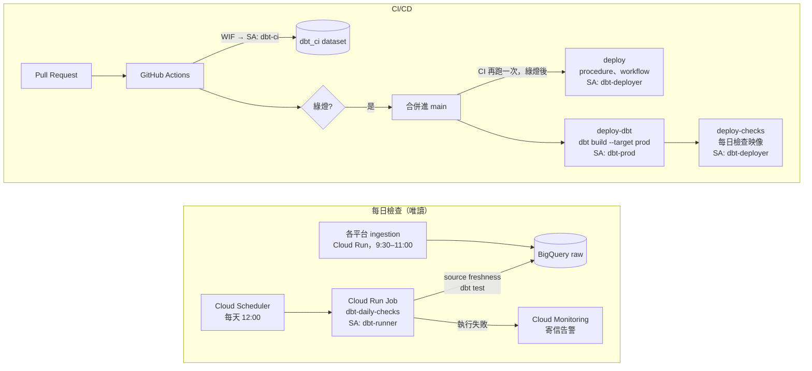
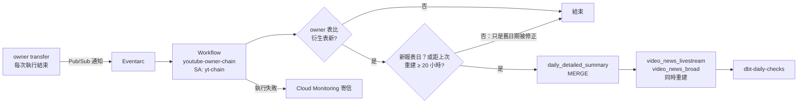

# 編排與 CI/CD

三件事：每天自動檢查 prod 的資料（編排）、每個 PR 自動驗證程式碼（CI）、合併進 main 後自動部署（CD）。



## 上游：YouTube Shorts 名單週更（yt-weekly，不在這個 repo）

`YouTube_data.video_metadata` 由 Cloud Run Job `yt-weekly` 寫入，原始碼在 `analytics_pipeline/news_youtube_scrape/cloudrun_yt_weekly/`。
- **怎麼寫入**：每週一 09:00、每月 4 號 10:00 用 YouTube Data / Analytics API MERGE，SA 是 `yt-weekly`。
- **誰讀**：dbt 只透過 `stg_youtube__shorts` 讀它，判斷哪些影片是 Shorts；source freshness 是每週規則（8 天警告 / 14 天報錯）。
- **出問題時**：freshness 報錯，代表 job 連續兩週沒成功，多半是 OAuth token 失效。處理方式見那個資料夾的 README「重新授權」。

## YouTube owner 事件驅動鏈

YouTube 內容擁有者報表（BQ Data Transfer）沒有固定的「跑完」時間：每天 09:30 的排程執行通常沒有新資料，報表日 D 的資料第一次進來落在 **D+2 的 13:37–23:51**（2026-10 觀察 11 天），之後 D+3 上午還會再被修正重寫。原本三個 BQ 排程查詢用固定時間（09:30 / 09:50 / 13:00）去猜，結果每天都比資料早到一步，最新一天要等到隔天才進衍生表；`daily_detailed_summary` 甚至在報表進來前就跑完。

改成由事件觸發：



- **判斷有沒有新資料**：比 `__TABLES__.last_modified_time`，不需要另存狀態；同一份資料重複通知也只會重建一次。
- **限流（2026-11-26 加）**：owner transfer 除了送新報表日，每天還會重寫幾天前的舊 partition 十幾次（YouTube 修正資料）。每次重寫都會更新 `last_modified_time`，所以 2026-11 每天全量重建 4–12 次，而且每次都會再跑一次 dbt 檢查。11/1–26 這兩個 SA 共掃了 2.7 TiB，是當月 BQ 費用從 USD 1.6 漲到約 21 的主因。現在的規則：
  - **有新報表日**（近 14 天內，有任何一天 owner `traffic_source_a3` 有、`daily_detailed_summary` 沒有）→ 馬上重建，資料一樣即時。這個規則和 `assert_youtube_summary_caught_up_with_owner` 相同，所以限流不會讓那個 test 誤報。
    - **為什麼逐日比對，不只比 MAX**：YouTube 會亂序送。2026-11-27 的 11/23 比 11/24 晚了快一天才到，第一版只比 MAX，把它當成「修正」，延後到 20 小時後才重建，衍生表缺了 11/23 一個早上。當時的 test 也只比 MAX，所以沒抓到；現在兩邊都改成逐日比對。
  - **只是舊日期被修正** → 距上次重建滿 20 小時才重建。平常隔天的新報表日重建就會順便帶進修正（video 表整張重建，daily summary MERGE 最近 14 天）。
  - 預估每天重建 1–1.3 次。判斷用的查詢約 50 KB。想立刻帶入修正，就手動跑 `--data='{"force": true}'`。
- **SQL** 在 [`sql/`](sql/)，部署成 `youtube_channel_summary` 裡的 stored procedure（`refresh_*`），內容與原排程查詢逐字相同（只拿掉寫死的專案 ID）。需要時可手動重跑：`CALL youtube_channel_summary.refresh_video_news_broad();`
- **執行身分** `yt-chain`：只讀 `youtube_taiwanplus_owner`、只寫 `youtube_channel_summary`，取代原本用個人帳號執行的排程查詢。
- 12:00 的每日檢查保留，負責 10:25 前就到齊的 IG / FB；YouTube 由這條鏈在最後觸發檢查。

上線與回滾：

```bash
P="--project=<gcp-project> --billing-project=<gcp-project>"
# 1. 建立 SA、procedure、Pub/Sub 通知、workflow、Eventarc、告警
GCP_PROJECT=<gcp-project> ALERT_EMAIL=<you@example.com> bash orchestration/setup_youtube_chain.sh
# 2. 手動跑一次，確認三張表更新、dbt 檢查通過
gcloud workflows run youtube-owner-chain --location=asia-east1 --data='{}' $P
# 3. 停用被取代的三個排程查詢（只設 disabled，不刪除）
GCP_PROJECT=<gcp-project> bash orchestration/toggle_old_schedules.sh disable
# 回滾：恢復排程查詢，再刪掉 Eventarc trigger 讓鏈停止
GCP_PROJECT=<gcp-project> bash orchestration/toggle_old_schedules.sh enable
gcloud eventarc triggers delete youtube-owner-transfer-finished --location=asia-east1 $P
```

## 為什麼每天只檢查、不重建

所有 model 都是 view，查詢時才讀原始表，所以 ingestion 一寫入，Looker 和 chatbox 就看得到新資料，不需要每天 `dbt build`。重建只在程式碼改動時才需要，也就是部署：合併進 main 後由 CD 的 `deploy-dbt` 自動執行 `dbt build --target prod`（見下方「CD 做什麼」）。

每天真正會變的是**資料本身**，所以每日 job 做兩件事：

| 步驟 | 抓什麼問題 |
|---|---|
| `dbt source freshness` | 某個平台的 ingestion 停了（API 權杖過期、排程被暫停……） |
| `dbt test` | 新資料破壞了假設：每日流量變負數、對帳不一致、出現沒登記的帳號、一則貼文對到兩支 VOD…… |

執行身分 `dbt-runner` 只有 `bigquery.dataViewer` + `bigquery.jobUser`，就算程式寫錯也改不到 prod。

## CI 做什麼

`.github/workflows/ci.yml`，每個 PR 與 main 的每次 push 都會跑：

| Job | 內容 |
|---|---|
| `chatbox-tests` | `chatbox_app` 的單元測試與 import 檢查，不需要 GCP |
| `dbt-build` | `dbt build --target ci`：整個專案建進 `dbt_ci` dataset，跑全部 test |

- **認證**：Workload Identity Federation。GitHub 簽發的 OIDC token 換成 `dbt-ci` SA 的短期憑證，沒有任何 SA 金鑰。WIF provider 只接受 `shangweiyang79/taiwanplus-dbt` 這個 repo 的 token；fork 來的 PR 拿不到 token，`dbt-build` 會跳過。
- **權限**：`dbt-ci` 可讀全部資料，但只能寫 `dbt_ci`。
- **為什麼不用 slim CI**（`state:modified+` + `--defer`）：整個專案約 50 個節點、全是 view，完整建一次只要幾分鐘，省下的時間不值得多維護一份 prod manifest。專案變大再加。
- **為什麼還沒有 sqlfluff**：sqlfluff 的 dbt templater 需要 dbt-core，和 dbt Fusion 裝在一起會衝突；Fusion 的 `dbt build` 本身已會做 SQL 靜態分析（欄位不存在會直接報錯）。

## CD 做什麼

同一個 `ci.yml` 裡的三個 job，只在 main 上、`chatbox-tests` 與 `dbt-build` 都綠燈後執行，把 main 的版本推到 prod：

| Job | 部署什麼 | 何時跑 | 執行身分 |
|---|---|---|---|
| `deploy` | `orchestration/sql/*.sql` → `youtube_channel_summary.refresh_*`；`orchestration/youtube_owner_chain.yaml` → workflow `youtube-owner-chain` | CI 綠燈後 | `dbt-deployer` |
| `deploy-dbt` | `dbt build --target prod`：重建 `dbt_internal`、`news_dept_social`、`social_hub` 裡的 view / seed，並跑全部 test | CI 綠燈後，與 `deploy` 同時 | `dbt-prod` |
| `deploy-checks` | 在 runner 上 `docker build`（build 時會 `dbt parse`），tag 用 commit SHA，推到 Artifact Registry 後 `gcloud run jobs update dbt-daily-checks` | `deploy-dbt` 成功才跑 | `dbt-deployer` |

- **為什麼不另設人工核准**：合併 PR 就是確認，而且合併前 `dbt-build` 已經把同一份程式碼完整建進 `dbt_ci`、跑過全部 test。prod build 失敗時 GitHub 會寄信。
- **為什麼映像要等 dbt build**：每日檢查用的是映像裡那份 test 定義。如果 view 還沒更新就先換映像，新的 test 會去查舊的 view，隔天 12:00 就會誤報。`deploy-dbt` 失敗時映像也不會換，檢查和 view 一直維持同一版。
- **每次都整套部署**，不判斷哪些檔案有改：每一步都可重複執行，而且有人在 console 手動改過的設定，下一次合併就會被拉回 main 的版本。只改 chatbox 或文件的 PR 也會把同樣的 view 重建一次（幾分鐘，結果不變）。
- **連續合併**：同一個 job 依序部署，排隊中的舊執行會被新的取代；反正每次都部署整個 main。
- **`dbt-deployer`**：只能推這個映像、改 `dbt-daily-checks` 這個 job、部署 workflow、寫 `youtube_channel_summary`、讀 `youtube_taiwanplus_owner`（`CREATE PROCEDURE` 會驗證 procedure 本體，要讀得到裡面查的表）。碰不到其他 Cloud Run 服務，也碰不到 dbt 的 prod dataset。
- **`dbt-prod`**：可讀全部資料（source 散在各平台的 dataset），只能寫 dbt 的三個 prod dataset。
- **只有 main 拿得到部署權限**：兩個 SA 的 WIF 都綁 OIDC `sub` = `repo:shangweiyang79@191815197/taiwanplus-dbt@1415308526:ref:refs/heads/main`。這個 repo 開了 immutable subject，sub 帶 owner 與 repo 的數字 ID，repo 被刪掉、別人再用同名建立也換不到。PR、其他分支、fork 就算改了 workflow 檔也拿不到。
- **回滾**：revert 那個 commit 再合併，三個 job 會把舊版推回去。急的話直接把 job 指回上一個映像：`gcloud run jobs update dbt-daily-checks --image=<上一個 SHA 的映像> --region=asia-east1 $P`；view 則在本機 checkout 舊 commit 跑 `dbt build --target prod`。

## 一次性設定

```bash
# 1. 在 repo 根目錄建立 GCP 資源（可重複執行）
GCP_PROJECT=<gcp-project> ALERT_EMAIL=<you@example.com> bash orchestration/setup_gcp.sh

# 2. 依腳本最後印出的值，到 GitHub repo → Settings → Secrets and variables → Actions
#    新增 GCP_PROJECT、GCP_WIF_PROVIDER、GCP_CI_SERVICE_ACCOUNT 三個 secret

# 3. （建議）Settings → Branches 幫 main 加 branch protection：要求 CI 通過才能合併

# 4. CD：建立 dbt-deployer、dbt-prod SA 與 WIF binding，
#    再依腳本最後印出的值新增 GCP_DEPLOY_SERVICE_ACCOUNT、GCP_PROD_SERVICE_ACCOUNT 兩個 secret
GCP_PROJECT=<gcp-project> bash orchestration/setup_cd.sh
```

## 日常操作

```bash
P="--project=<gcp-project> --billing-project=<gcp-project>"

# 手動跑一次每日檢查
gcloud run jobs execute dbt-daily-checks --region=asia-east1 $P

# 看最近幾次執行結果
gcloud run jobs executions list --job=dbt-daily-checks --region=asia-east1 $P --limit=5

# 看 job 現在跑的是哪個 commit（映像 tag = commit SHA）
gcloud run jobs describe dbt-daily-checks --region=asia-east1 $P --format='value(spec.template.spec.template.spec.containers[0].image)'
```

改了 model / test 不用再手動更新 job 的映像：合併進 main 後 CD 會自動重建。

**收到告警信時**：到 Cloud Run → Jobs → `dbt-daily-checks` 打開那次執行的 log，往上找 `ERROR` / `FAIL`，再依下表判斷。

| log 裡看到 | 代表什麼 | 要做什麼 | 能等到週一嗎 |
|---|---|---|---|
| 只有 `youtube.daily_detailed_summary` stale | YouTube 晚送超過 7 天（不是我們壞掉） | 確認 BQ Data Transfer `youtube_taiwanplus_owner` 的執行沒有失敗即可，資料到了會自己恢復 | 可以 |
| `assert_youtube_summary_caught_up_with_owner` 失敗 | owner 表有新資料、衍生表沒跟上：Eventarc 沒觸發或 procedure 壞了 | 看 Workflows → `youtube-owner-chain` 的執行紀錄，修好後 `gcloud workflows run youtube-owner-chain --location=asia-east1 --data='{"force": true}' $P` | 可以，procedure MERGE 最近 14 天 |
| `assert_bq_scan_within_budget` 失敗 | 近 7 天**自動化**（服務帳號 + BQ 排程查詢）的計費掃描量超過 450 GiB。人手動的查詢和 CI / CD 不算。失敗列會列出掃描量、推估月費，以及掃最多的 3 個帳號 | 查掃最多的那個帳號被觸發了幾次（Workflow 的 executions list、Scheduler、Eventarc、排程查詢），見下方「成本防線」 | 可以，但一週內要處理 |
| 其他 source freshness | 該平台的 ingestion 停了 | 查對應的 Cloud Run 服務 log、Scheduler 是否被暫停、權杖是否過期 | 看平台：快照類（IG reels 累計值）停太久會缺日資料 |
| 其他 test 失敗 | 新資料破壞了假設 | 本機 `dbt test --target prod --select <test 名稱>` 重現，再用 `dbt show` 看是哪幾列 | 通常可以，數字錯誤會留在 view 直到修正 |

`youtube-owner-chain failed` 的信只代表這條鏈自己的步驟出錯：判斷新資料、三個 procedure，或 jobs.run 呼叫本身。dbt 檢查沒過不會讓 workflow 失敗，只會寄 `dbt-daily-checks failed` 那一封。

### 成本防線：`assert_bq_scan_within_budget`（2026-11-26 加）

2026-11 這條 YouTube 鏈被 owner transfer 的修正寫入一天觸發 4–12 次，一個月掃了 2.7 TiB，等帳單出來才發現。為了下次幾天內就能發現，每日檢查加了這個 test：

- **看什麼**：`region-asia-east1` 近 7 天（台北時間）**自動化**的 `total_bytes_billed`。SCRIPT 父 job 要排除，否則會重複計算。
  - **算進來**：服務帳號，以及所有 BQ 排程查詢。有些排程查詢掛在個人帳號下（joy.yang、cynthia.liu），所以用 `job_id` 的 `scheduled_query` 前綴來判斷。
  - **不算**：人手動的查詢、CI（`dbt-ci`）、CD（`dbt-prod`、`dbt-deployer`）。開發日一天就 100+ GiB（一次 PR 的 CI 約 15–25 GiB，一次 CD 約 10–20 GiB），連續幾天開發就會誤報，而且那是自己知道的花費。第一版把這些都算進去，11/27 開發日就誤報了兩次。
- **門檻**：450 GiB/7 天。依據是 2026-11-27 實測近 90 天各類別的 7 天用量：

  | 類別 | 平常一週 | 偏多的一週 |
  |---|---:|---:|
  | yt-chain（限流後預估，每次重建約 7.4 GiB） | ~60 | ~105 |
  | dbt-runner（每次檢查約 10 GiB；12:00 一次 + 每次重建後一次） | ~150 | ~210 |
  | BQ 排程查詢 | 26 | 51 |
  | ingestion（預設 compute SA，含 FB 月回刷） | 12 | 46 |
  | youtube-shorts-fetcher | ~5 | 29 |
  | chatbox | ~0 | 69 |
  | 每週 / 每月的 Cloud Run job（yt-weekly、yt-retention、news-classify） | ~0 | 0.5 |
  | **合計** | **~260** | **~510**（所有最大值同一週疊在一起，極少發生） |

  11 月失控時，自動化每週 600–890 GiB，失控開始後約 2–3 天累積到門檻就會寄信。**2026-12-03 滿一週後要用實測值重新校準**，門檻改成實際平常週的約 1.7 倍。
- **只在每日檢查跑**：由 `daily_checks.sh` 設 `DBT_COST_CHECK=true` 才會啟用。CI / CD 不跑，免得成本高的時候連修正都部署不上去。
- **權限**：`dbt-runner` 多了專案層級的 `roles/bigquery.resourceViewer`（`jobs.listAll`），由 `setup_gcp.sh` 授予。
- **調整**：門檻用 `--vars '{bq_7d_scan_limit_gib: 500}'` 調。`bq_scan_check_since` 是限流上線那天（2026-11-27），讓前 7 天不會被舊資料拖累，12/3 以後就沒有作用了。視窗不滿 7 天時門檻**不**縮小，第一版有縮小，第一天門檻只剩 71 GiB，所以誤報。
- **查是誰在掃**：
  ```sql
  SELECT DATE(creation_time,'Asia/Taipei') d, user_email, COUNT(*) jobs,
         ROUND(SUM(total_bytes_billed)/POW(1024,3),1) gib
  FROM `region-asia-east1`.INFORMATION_SCHEMA.JOBS_BY_PROJECT
  WHERE creation_time >= TIMESTAMP_SUB(CURRENT_TIMESTAMP(), INTERVAL 7 DAY)
    AND statement_type IS DISTINCT FROM 'SCRIPT'
  GROUP BY 1, 2 ORDER BY 1 DESC, gib DESC
  ```

### 為什麼 YouTube freshness 門檻是 5 / 7 天

2026-11-14、15 週末收到 7 次 freshness 錯誤，全部都是 `daily_detailed_summary`，52 個 test 都通過。原因是 YouTube 晚送了報表日 11/10–11/12（D+4 到 D+5 才進來，11/11 甚至比 11/12、11/13 還晚），DTS 每次執行都是 SUCCEEDED，資料到齊後自動恢復。

用 load job 紀錄重算 2026-06 到 11 月「最新報表日落後幾天」：最大 5.85 天，≥4 天 26 次，≥5 天 3 次。所以舊門檻（4 / 5 天）在 YouTube 慢一點時就會誤報，現在改成 warn 5 天、error 7 天。放寬後，「我們自己的鏈斷了」交給 `assert_youtube_summary_caught_up_with_owner` 抓：只要 owner 表 3 小時前就有的報表日、衍生表沒有，隔天 12:00 就會報錯，不受 YouTube 延遲影響。

也比較過改讀 `p_content_owner_combined_a3_owner` 會不會比較早：78% 的報表日兩張表同一小時進來，其餘互有先後（combined 早到 27 天、traffic_source 早到 15 天），重算落後天數最大一樣是 5.85 天，所以沒有換。

dbt 版本固定在 2.0.9（本機、CI、Dockerfile 三處一致）。升級時三處一起改。
