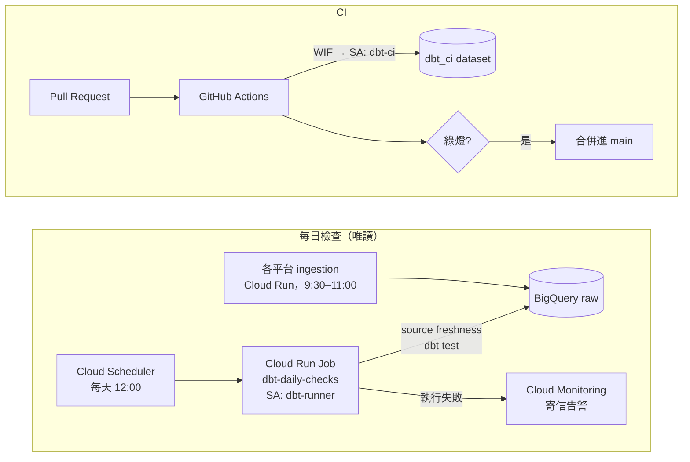

# 編排與 CI

兩件事：每天自動檢查 prod 的資料（編排），以及每個 PR 自動驗證程式碼（CI）。



## 為什麼每天只檢查、不重建

所有 model 都是 view，查詢時才讀原始表，所以 ingestion 一寫入，Looker 和 chatbox 就看得到新資料，不需要每天 `dbt build`。重建只在程式碼改動時才需要，也就是部署；部署目前仍由人手動執行 `dbt build --target prod`。

每天真正會變的是**資料本身**，所以每日 job 做兩件事：

| 步驟 | 抓什麼問題 |
|---|---|
| `dbt source freshness` | 某個平台的 ingestion 停了（API 權杖過期、排程被暫停……） |
| `dbt test` | 新資料破壞了假設：每日流量變負數、對帳不一致、出現沒登記的帳號、一則貼文對到兩支 VOD…… |

執行身分 `dbt-runner` 只有 `bigquery.dataViewer` + `bigquery.jobUser`，就算程式寫錯也改不到 prod。

## CI 做什麼

`.github/workflows/ci.yml`，每個 PR 與 main 的每次 push 都會跑：

| Job | 內容 |
|---|---|
| `chatbox-tests` | `chatbox_app` 的單元測試與 import 檢查，不需要 GCP |
| `dbt-build` | `dbt build --target ci`：整個專案建進 `dbt_ci` dataset，跑全部 test |

- **認證**：Workload Identity Federation。GitHub 簽發的 OIDC token 換成 `dbt-ci` SA 的短期憑證，沒有任何 SA 金鑰。WIF provider 只接受 `shangweiyang79/taiwanplus-dbt` 這個 repo 的 token；fork 來的 PR 拿不到 token，`dbt-build` 會跳過。
- **權限**：`dbt-ci` 可讀全部資料，但只能寫 `dbt_ci`。
- **為什麼不用 slim CI**（`state:modified+` + `--defer`）：整個專案約 50 個節點、全是 view，完整建一次只要幾分鐘，省下的時間不值得多維護一份 prod manifest。專案變大再加。
- **為什麼還沒有 sqlfluff**：sqlfluff 的 dbt templater 需要 dbt-core，和 dbt Fusion 裝在一起會衝突；Fusion 的 `dbt build` 本身已會做 SQL 靜態分析（欄位不存在會直接報錯）。

## 一次性設定

```bash
# 1. 在 repo 根目錄建立 GCP 資源（可重複執行）
GCP_PROJECT=<gcp-project> ALERT_EMAIL=<you@example.com> bash orchestration/setup_gcp.sh

# 2. 依腳本最後印出的值，到 GitHub repo → Settings → Secrets and variables → Actions
#    新增 GCP_PROJECT、GCP_WIF_PROVIDER、GCP_CI_SERVICE_ACCOUNT 三個 secret

# 3. （建議）Settings → Branches 幫 main 加 branch protection：要求 CI 通過才能合併
```

## 日常操作

```bash
P="--project=<gcp-project> --billing-project=<gcp-project>"

# 手動跑一次每日檢查
gcloud run jobs execute dbt-daily-checks --region=asia-east1 $P

# 看最近幾次執行結果
gcloud run jobs executions list --job=dbt-daily-checks --region=asia-east1 $P --limit=5

# 改了 model / test 之後更新 job 的映像（job 用的是部署當下的程式碼）
gcloud run jobs deploy dbt-daily-checks --source=. --region=asia-east1 $P
```

**收到告警信時**：到 Cloud Run → Jobs → `dbt-daily-checks` 打開那次執行的 log，往上找 `ERROR` / `FAIL`。

- freshness 錯誤：去查對應平台的 ingestion 服務（Cloud Run 服務的 log、Scheduler 是否被暫停）。
- test 失敗：在本機用 `dbt test --target prod --select <test 名稱>` 重現，再用 `dbt show` 看是哪幾列。

dbt 版本固定在 2.0.9（本機、CI、Dockerfile 三處一致）。升級時三處一起改。
